# ShopBrasil – Pipeline de preços por categoria (Apache Airflow)

Pipeline em Apache Airflow que substitui o script Python anteriormente agendado via cron.
As tasks buscam os produtos da API de catálogo ([FakeStore API](https://fakestoreapi.com/docs)), calculam por categoria as **quantidades de produtos** e os preços **médio, mínimo e máximo**, e gravam os resultados em um **PostgreSQL** analítico.

---

## 1. Estrutura do projeto

```
airflow-shopbrasil/
├── docker-compose.yaml                     # Airflow + Postgres (metadados) + Postgres (DW)
├── .env.example                            # variáveis de ambiente (copiadas para .env)
├── sql/
│   └── 01_criar_tabelas.sql                # DDLs da base analítica (executados na 1ª inicialização)
├── dags/
│   ├── shopbrasil_precos_por_categoria.py  # definição da DAG
│   └── common/
│       ├── config.py                       # constantes (URL da API, conn_id, pool, tabelas)
│       └── alertas.py                      # callbacks de falha/retry/sucesso/SLA
└── plugins/
    └── operators/
        └── validar_produtos.py             # ValidarProdutosOperator(BaseOperator)
```

---

## 2. Procedimentos de execução

**Pré-requisitos:** os usuários necessitam do Docker e do Docker Compose instalados (Docker Desktop em Windows/macOS).

**Etapa 1 – Criação do `.env` e da pasta de logs**

Os usuários copiam o arquivo de exemplo e criam a pasta de logs:

```bash
cp .env.example .env
mkdir -p logs
```

> Em sistemas Linux, os usuários substituem `AIRFLOW_UID` no `.env` pelo resultado de `id -u`.

**Etapa 2 – Inicialização do ambiente**

```bash
docker compose up -d
```

Na primeira inicialização, os comandos do `airflow-init`:

1. migram o banco de metadados do Airflow;
2. criam o usuário `airflow` / senha `airflow`;
3. criam o pool **`ecommerce_pool` com 2 slots**.

Os usuários acompanham o processo com `docker compose ps` até que o `airflow-webserver` atinja o estado `healthy` (aproximadamente 1 minuto).

**Etapa 3 – Acesso à interface**

Os usuários acessam [http://localhost:8080](http://localhost:8080) e realizam login com `airflow` / `airflow`.

**Etapa 4 – Ativação e disparo da DAG**

1. Localizam a DAG `shopbrasil_precos_por_categoria`.
2. Ativam o toggle (as DAGs iniciam pausadas).
3. Acionam ▶ **Trigger DAG** para executá-la imediatamente, sem aguardar as 06:00.
4. Na aba **Graph**, visualizam os 3 TaskGroups e as tasks mapeadas por categoria.

**Etapa 5 – Conferência dos dados no PostgreSQL**

```bash
docker compose exec postgres-dw psql -U dw_user -d shopbrasil_dw
```

```sql
-- Consultam-se os painéis do dia (snapshot)
SELECT * FROM metricas_categoria_snapshot ORDER BY data_referencia DESC, categoria;

-- Consultam-se as evoluções dos preços (histórico)
SELECT data_referencia, run_id, categoria, preco_medio, coletado_em
FROM metricas_categoria_historico ORDER BY coletado_em DESC;
```

Os usuários também podem conectar clientes externos (DBeaver, por exemplo) em `localhost:5433`, banco `shopbrasil_dw`, usuário `dw_user`, senha `dw_pass`.

**Etapa 6 – Verificação da idempotência**

Na UI, os usuários abrem a run concluída, selecionam a task `persistencia.salvar_snapshot` → **Clear** → confirmam.
As tasks executam novamente e os resultados de `SELECT COUNT(*) FROM metricas_categoria_snapshot;` permanecem inalterados.
(As tabelas de histórico recebem novas linhas: esse comportamento é esperado, pois operam em modo *append*.)

**Etapa 7 – Inspeção dos alertas simulados**

```bash
cat logs/alertas.log
```

**Encerramento:** os usuários executam `docker compose down` (mantém os dados) ou `docker compose down -v` (remove os volumes).

---

## 3. Atendimento aos requisitos

| Requisito                                     | Localização / implementação                                                                                                                                                                                                                                                                                                            |
| --------------------------------------------- | ------------------------------------------------------------------------------------------------------------------------------------------------------------------------------------------------------------------------------------------------------------------------------------------------------------------------------------------ |
| **TaskFlow API** (`@dag` / `@task`) | Empregam-se decorators em toda a DAG; as dependências decorrem das chamadas das funções (`agrupar_por_categoria(produtos_validos.output)`, `analise(grupos)` …).                                                                                                                                                           |
| **XComs automáticos via `return`**   | As tasks retornam seus resultados. As tasks `buscar_produtos` devolvem apenas `id`, `title`, `price` e `category`, mantendo-se os XComs pequenos.                                                                                                                                                                                |
| **Topologia linear**                    | Grupo `ingestao`: `buscar_produtos → validar_produtos → agrupar_por_categoria`.                                                                                                                                                                                                                                                      |
| **Fan-out**                             | `calcular_metricas.expand(grupo=...)`: geram-se tasks por categoria.                                                                                                                                                                                                                                                                     |
| **Fan-in**                              | As tasks `consolidar_metricas` recebem as listas com os resultados de todas as tasks mapeadas.                                                                                                                                                                                                                                           |
| **Agendamento 06:00 Brasília**         | `schedule="0 6 * * *"`, `start_date=pendulum.datetime(..., tz="America/Sao_Paulo")`, `catchup=False`.                                                                                                                                                                                                                                |
| **Retry com exponential backoff**       | `buscar_produtos`: `retries=5`, `retry_delay=30s`, `retry_exponential_backoff=True`, `max_retry_delay=10min`.                                                                                                                                                                                                                    |
| **try/except + raise**                  | As tasks `buscar_produtos` capturam `RequestException`/`ValueError`, registram os erros e executam `raise` para que o Airflow dispare os retries.                                                                                                                                                                                  |
| **Callbacks de ciclo de vida**          | Configuram-se `on_failure_callback`, `on_retry_callback` e `on_success_callback` em `buscar_produtos` (`dags/common/alertas.py`).                                                                                                                                                                                                |
| **Dynamic Task Mapping**                | Aplicam-se `.expand()` em `calcular_metricas`. As novas categorias da API recebem automaticamente novas tasks, sem alterações no código.                                                                                                                                                                                            |
| **Pool `ecommerce_pool` (2 slots)**   | Os comandos do `airflow-init` criam o pool; as tasks `calcular_metricas` utilizam `pool="ecommerce_pool"`.                                                                                                                                                                                                                           |
| **≥ 2 TaskGroups**                     | `ingestao`, `analise` e `persistencia`.                                                                                                                                                                                                                                                                                              |
| **PostgresHook + Connection**           | Definem-se as Connections `postgres_dw` pela variável `AIRFLOW_CONN_POSTGRES_DW` no `docker-compose.yaml`.                                                                                                                                                                                                                          |
| **Gravação idempotente**              | As tabelas `metricas_categoria_snapshot` possuem `PRIMARY KEY (data_referencia, categoria)` + `INSERT … ON CONFLICT DO UPDATE`, executados em transações. As `data_referencia` derivam do `data_interval_end` das runs (e não do horário corrente); assim, as reexecuções de uma mesma run recaem sobre as mesmas linhas. |
| *(Opcional)* **Operador customizado** | `ValidarProdutosOperator(BaseOperator)` em `plugins/operators/validar_produtos.py`.                                                                                                                                                                                                                                                    |
| *(Opcional)* **Tabela de histórico** | `metricas_categoria_historico`, em modo append, com `run_id` e `coletado_em`.                                                                                                                                                                                                                                                        |
| *(Opcional)* **SLA / alerta**         | Configuram-se `sla=30min` em `buscar_produtos` + `sla_miss_callback`; os `on_failure_callback` simulam os envios dos alertas (log + `logs/alertas.log`).                                                                                                                                                                         |

---

## 4. Decisões de projeto (padrões adotados pelas equipes)

- **Configurações centralizadas** em `dags/common/config.py`: reúnem-se URLs, conn_ids, pools e nomes de tabelas em um único local.
- **Categorias derivadas dos dados**, e não de listas fixas no código. Essas derivações conferem escalabilidade ao pipeline.
- **Validações anteriores aos cálculos:** caso as APIs alterem os formatos, os operadores descartam os produtos inválidos e registram os motivos no log, em vez de gravarem números incorretos nos painéis.
- **`max_active_runs=1`**: impedem-se disputas de execuções simultâneas pelas mesmas tabelas.
- **Snapshots x históricos:** os snapshots representam as "verdades do dia" (idempotentes) e os históricos constituem os "filmes" (append).
- **Airflow 2.10**: adotam-se versões estáveis que ainda suportam `sla` / `sla_miss_callback` (os SLAs foram removidos no Airflow 3).

---

## 5. Testes de resiliência (opcionais)

Para observarem os retries com backoff e os callbacks em funcionamento, os usuários substituem temporariamente `API_BASE_URL` em `dags/common/config.py` por URLs inválidas (ex.: `https://fakestoreapi.com/xyz`), disparam a DAG e acompanham:

- na UI, as tasks `ingestao.buscar_produtos` no estado `up_for_retry`, com intervalos progressivamente maiores;
- em `logs/alertas.log`, as linhas `[AVISO] Retentando…` e, ao se esgotarem as tentativas, `[CRITICO] Falha definitiva!`.

Ao final, os usuários restauram as URLs originais.

---

## 6. Resultados obtidos

Registram-se, a seguir, as evidências da execução manual `manual__2026-11-26T03:08:56+00:00`, concluída com sucesso em 8 segundos. As imagens permanecem armazenadas em `docs/prints/`.

**Figura 1 – Documentação da DAG exibida na interface (`doc_md`)**

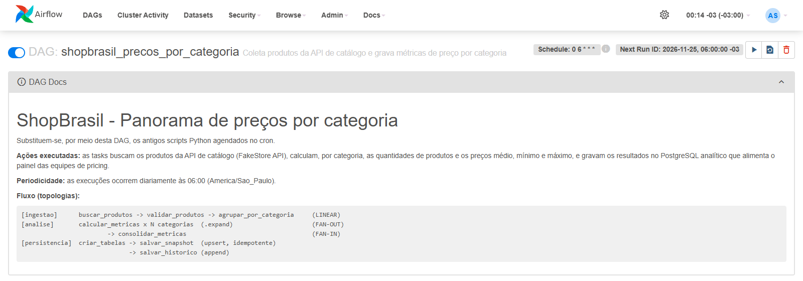

**Figura 2 – Listagem das DAGs:** apresentam-se a DAG ativa, as tags, o agendamento `0 6 * * *` e as execuções concluídas.

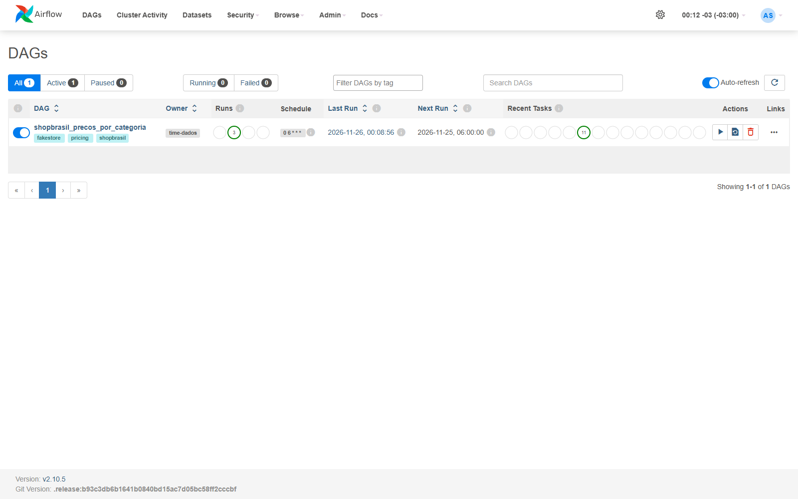

**Figura 3 – Grid da execução:** exibem-se os três TaskGroups expandidos e o estado `success` de todas as tasks.

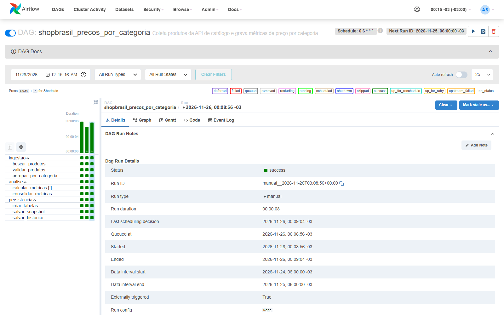

**Figura 4 – Graph da execução:** evidenciam-se as topologias linear (`ingestao`), fan-out/fan-in (`analise`, com `calcular_metricas [4]`) e a persistência paralela.

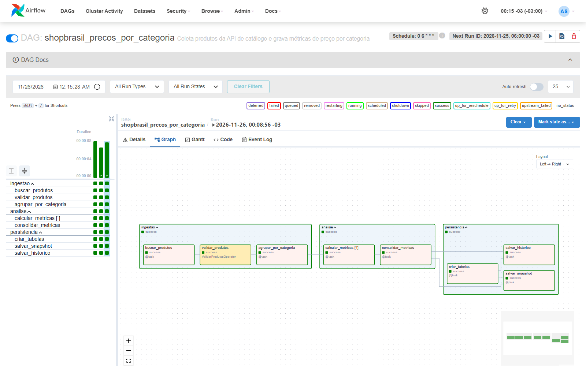

**Figura 5 – Tasks mapeadas dinamicamente:** geram-se 4 instâncias de `calcular_metricas`, uma por categoria.

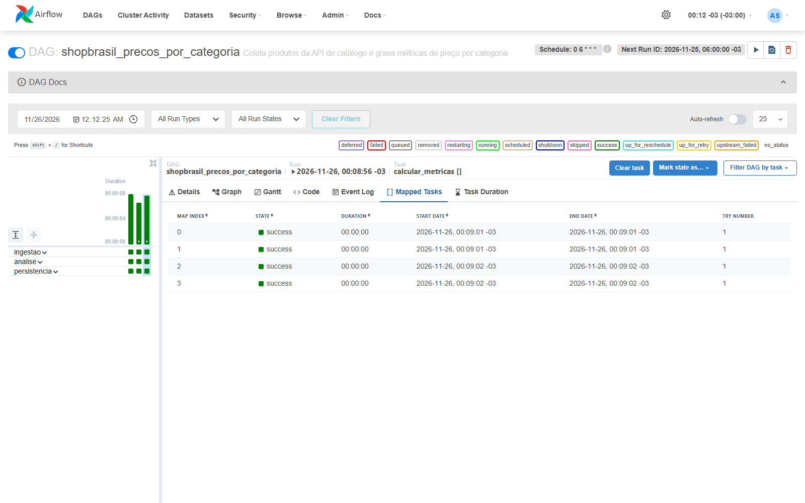

**Figura 6 – Log de `consolidar_metricas`:** registram-se as métricas consolidadas por categoria.

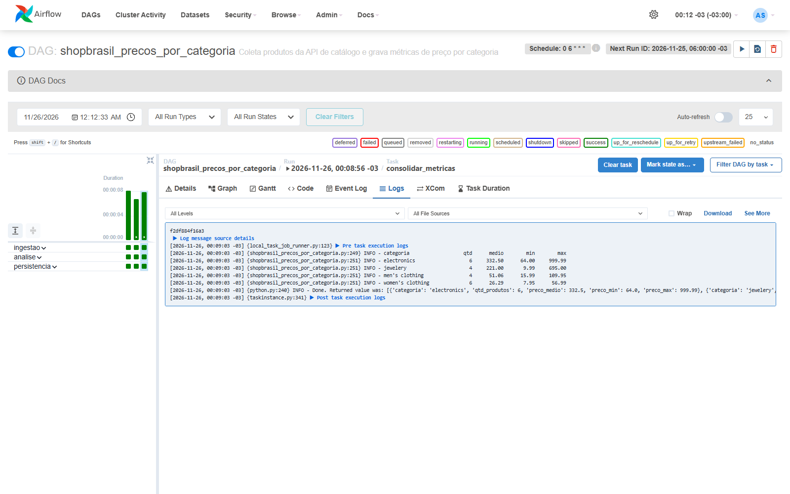

**Figura 7 – Log de `salvar_snapshot`:** confirmam-se as gravações idempotentes no PostgreSQL.

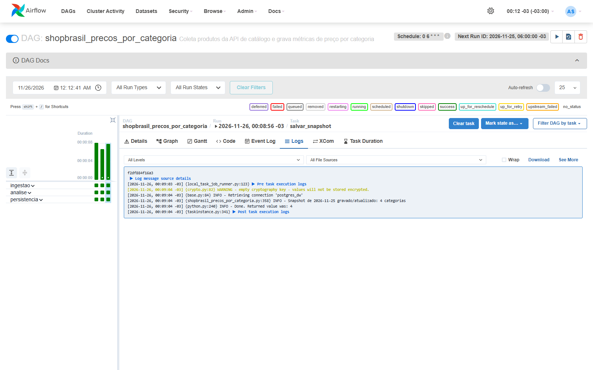

**Figura 8 – Pools configurados:** verifica-se o `ecommerce_pool` com 2 slots.

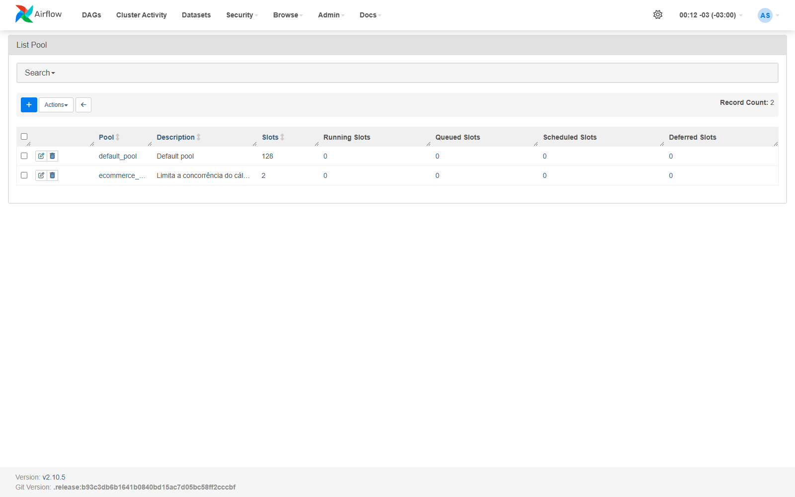

**Figura 9 – Tabela `metricas_categoria_snapshot`:** mantêm-se 4 linhas (uma por categoria), mesmo após múltiplas execuções da mesma data de referência.

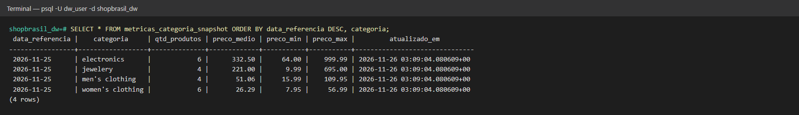

**Figura 10 – Tabela `metricas_categoria_historico`:** acumulam-se as linhas de cada execução (modo append), identificadas por `run_id`.

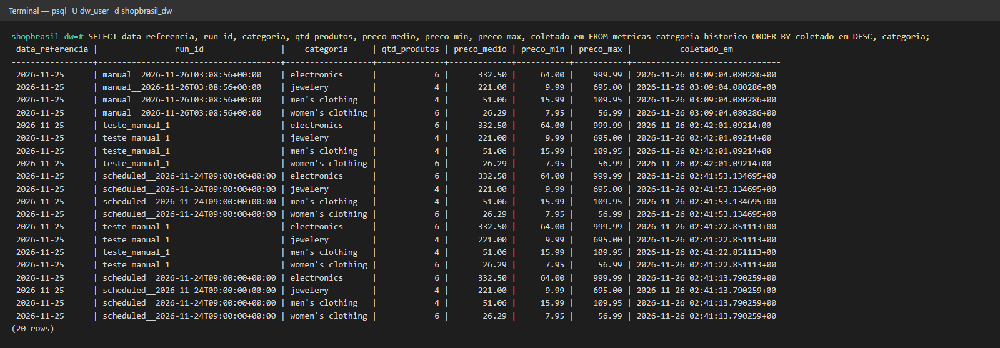

**Figura 11 – Arquivo `logs/alertas.log`:** registram-se os alertas simulados emitidos pelos callbacks.

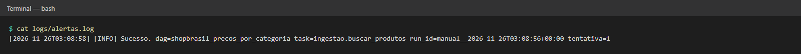
