# ShopBrasil – Resultados da execução

[← Voltar ao README](README.md)

Registram-se, neste documento, as evidências da execução manual `manual__2026-11-26T03:08:56+00:00` da DAG `shopbrasil_precos_por_categoria`, concluída com estado `success` em 8 segundos. As imagens permanecem armazenadas em [`docs/prints/`](docs/prints/).

## Sumário

1. [Síntese dos resultados](#1-síntese-dos-resultados)
2. [Interface do Airflow](#2-interface-do-airflow)
3. [Logs das tasks](#3-logs-das-tasks)
4. [Dados persistidos no PostgreSQL](#4-dados-persistidos-no-postgresql)
5. [Alertas simulados](#5-alertas-simulados)
6. [Observações metodológicas](#6-observações-metodológicas)

---

## 1. Síntese dos resultados

| Indicador | Valor observado |
|---|---|
| Estado da execução | `success` (todas as tasks) |
| Duração total | 8 segundos |
| Produtos recebidos da API | 20 |
| Categorias identificadas | 4 |
| Instâncias mapeadas de `calcular_metricas` | 4 |
| Linhas no snapshot após reexecuções | 4 (sem duplicação) |
| Linhas no histórico | 20 (5 execuções × 4 categorias, modo append) |

Obtiveram-se as seguintes métricas por categoria (data de referência `2026-11-25`):

| Categoria | Qtd. produtos | Preço médio | Preço mínimo | Preço máximo |
|---|---:|---:|---:|---:|
| electronics | 6 | 332,50 | 64,00 | 999,99 |
| jewelery | 4 | 221,00 | 9,99 | 695,00 |
| men's clothing | 4 | 51,06 | 15,99 | 109,95 |
| women's clothing | 6 | 26,29 | 7,95 | 56,99 |

---

## 2. Interface do Airflow

**Figura 1 – Documentação da DAG exibida na interface (`doc_md`):** apresentam-se o objetivo, a periodicidade e as topologias do fluxo.

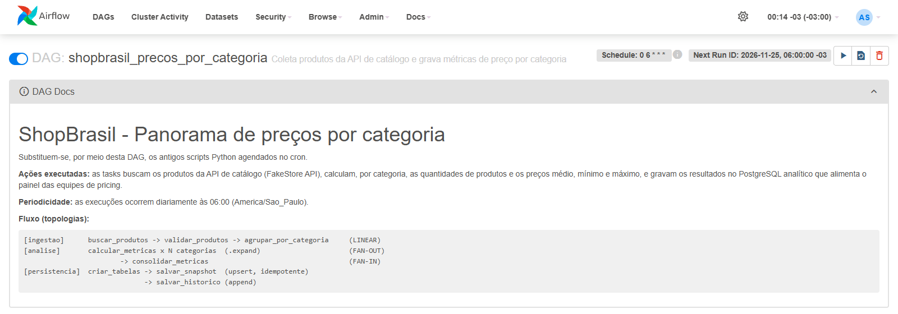

**Figura 2 – Listagem das DAGs:** apresentam-se a DAG ativa, as tags, o agendamento `0 6 * * *` e as execuções concluídas.

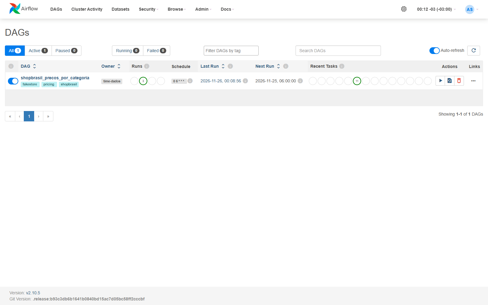

**Figura 3 – Grid da execução:** exibem-se os três TaskGroups expandidos e o estado `success` de todas as tasks.

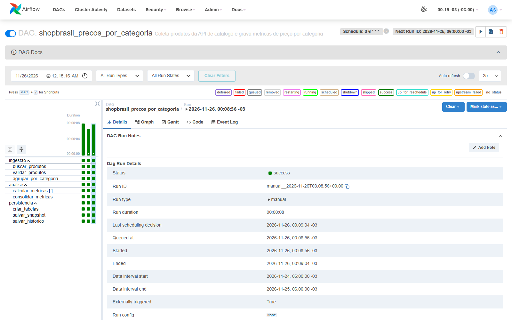

**Figura 4 – Graph da execução:** evidenciam-se as topologias linear (`ingestao`), fan-out/fan-in (`analise`, com `calcular_metricas [4]`) e a persistência paralela.

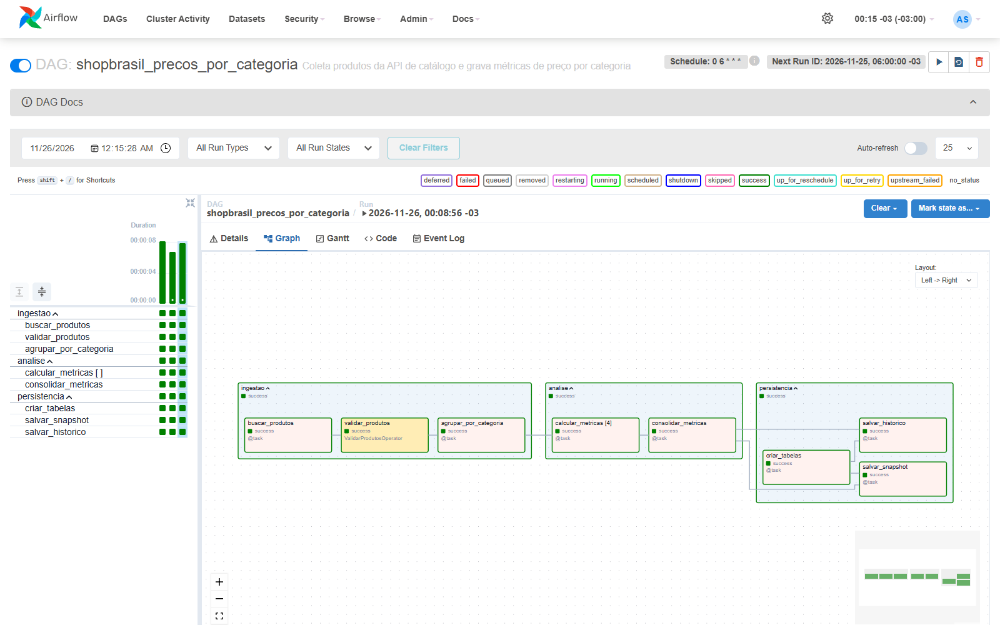

**Figura 5 – Tasks mapeadas dinamicamente:** geram-se 4 instâncias de `calcular_metricas`, uma por categoria.

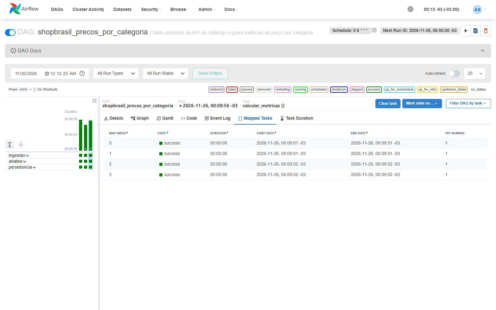

**Figura 6 – Pools configurados:** verifica-se o `ecommerce_pool` com 2 slots.

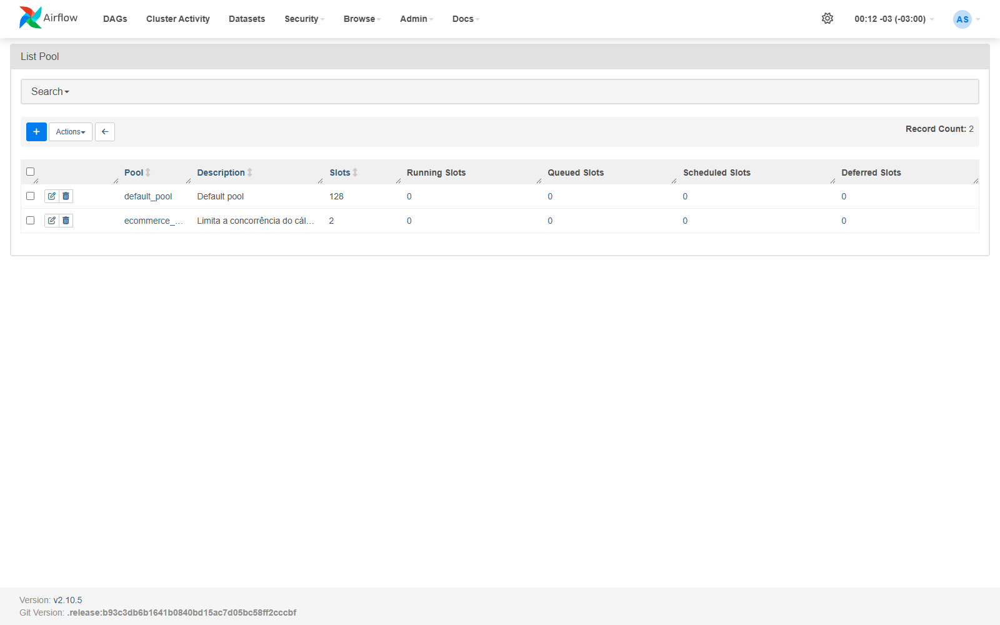

---

## 3. Logs das tasks

**Figura 7 – Log de `consolidar_metricas`:** registram-se as métricas consolidadas por categoria (fan-in).

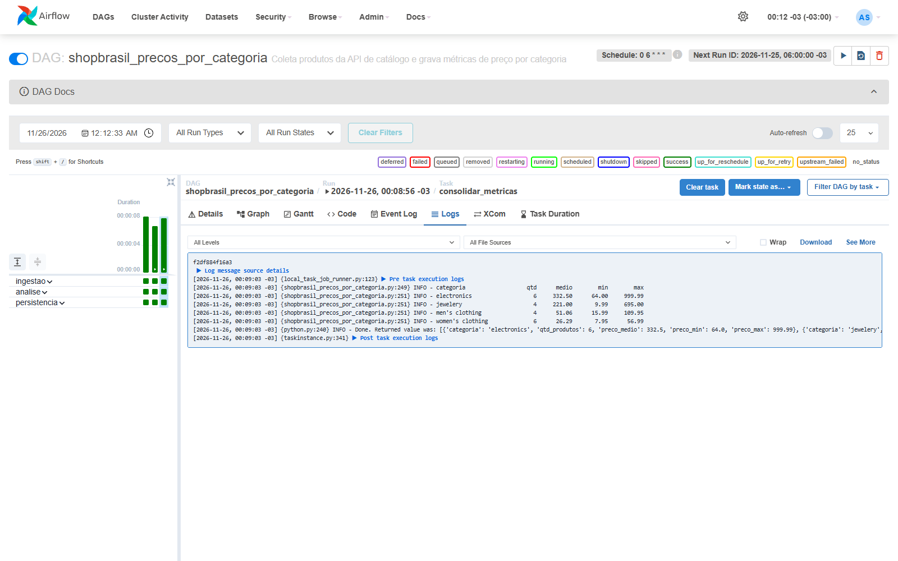

**Figura 8 – Log de `salvar_snapshot`:** confirmam-se as gravações idempotentes de 4 categorias no PostgreSQL.

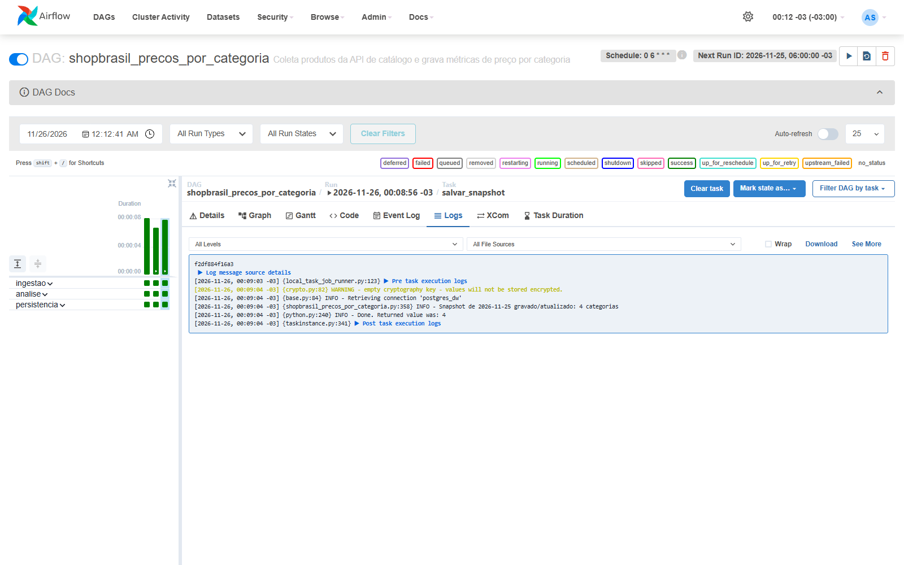

---

## 4. Dados persistidos no PostgreSQL

**Figura 9 – Tabela `metricas_categoria_snapshot`:** mantêm-se 4 linhas (uma por categoria), mesmo após múltiplas execuções da mesma data de referência, o que comprova a idempotência do upsert.

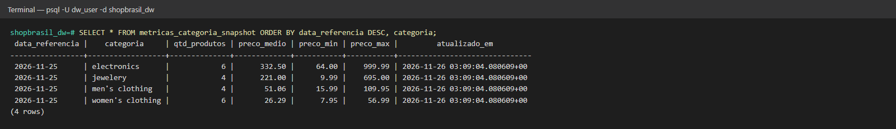

**Figura 10 – Tabela `metricas_categoria_historico`:** acumulam-se as linhas de cada execução (modo append), identificadas por `run_id`.

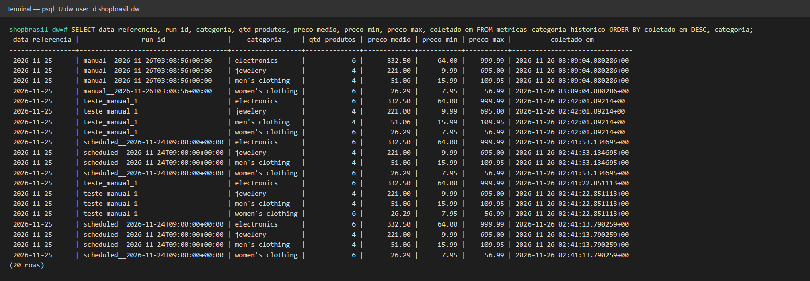

---

## 5. Alertas simulados

**Figura 11 – Arquivo `logs/alertas.log`:** registram-se os alertas simulados emitidos pelos callbacks. Na execução analisada, emitiu-se apenas o alerta de sucesso de `ingestao.buscar_produtos`, pois não ocorreram falhas nem novas tentativas.

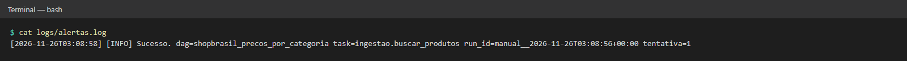

---

## 6. Observações metodológicas

- As Figuras 1 a 8 consistem em capturas da interface web do Airflow 2.10.5, obtidas com navegador em modo headless.
- As Figuras 9 a 11 representam, em formato de terminal, as saídas reais das consultas `psql` e do arquivo `logs/alertas.log`, uma vez que esses conteúdos não possuem tela correspondente na interface do Airflow.
- O histórico (Figura 10) inclui, além da execução analisada, as linhas de execuções anteriores (`teste_manual_1` e `scheduled__2026-11-24T09:00:00+00:00`), preservadas pelo modo append.
